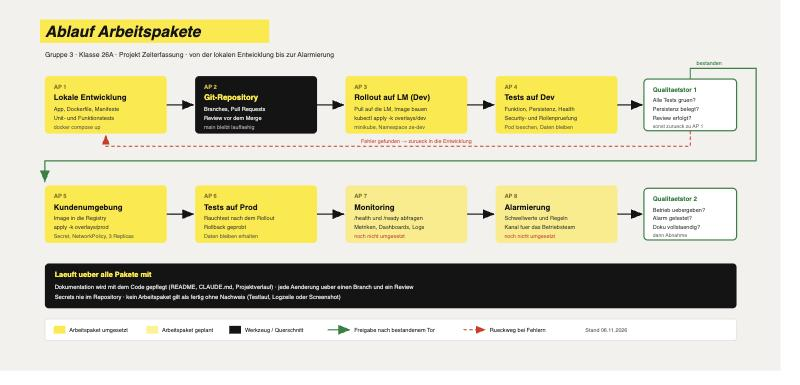

# Ablauf und Arbeitspakete

**Gruppe 3 · Klasse 26A · SAII**
Ruben F. · Kiril R. · Daniel E. · Stand 06.11.2026
Projekt: Zeiterfassung auf Kubernetes
Repository: https://github.com/KiruKiril/SAII_Zeiterfassung



---

## 1. Git-Aufbau

Ein gemeinsames Repository auf GitHub, `main` bleibt jederzeit lauffähig.

| Thema | Regelung |
|---|---|
| Branches | `main` ist geschützt. Jede Änderung läuft über einen Branch `feature/<kurz>` oder `fix/<kurz>`. |
| Merge | Erst nach Review durch ein zweites Gruppenmitglied und grünen Tests. |
| Commits | Deutsch, Betreffzeile knapp, Begründung im Rumpf — nicht nur *was*, sondern *warum*. |
| Secrets | Nie im Repository. `k8s/make-secret.sh` erzeugt sie zur Laufzeit im Cluster, `k8s/secret.example.yaml` zeigt nur die Struktur. |
| Grosse Dateien | Rohaufnahmen und Build-Artefakte gehören in `.gitignore`. |
| Einstieg | `CLAUDE.md` wird von Claude Code automatisch geladen und bringt jede neue Sitzung auf den Stand. |

**Struktur**

```
app/       Anwendung, Dockerfile, Tests
k8s/       base + overlays/dev + overlays/prod
docs/      Abgabedokument, Netzwerkplan, Ablauf, Bilder
```

---

## 2. Arbeitspakete

### AP 1 — Lokale Entwicklung  ·  erledigt
**Ziel:** Die Anwendung läuft auf dem eigenen Rechner und ist getestet.
**Inhalt:** Flask-App mit Zustandsautomat, Persistenz nach `/data`, Dockerfile als Non-Root, Kubernetes-Manifeste, automatisierte Tests.
**Nachweis:** `docker compose up --build` erreichbar, `python3 app/test_app.py` → 128 Tests grün.
**Aufwand:** ca. 4 h

### AP 2 — Git-Repository aufbauen  ·  erledigt
**Ziel:** Alle arbeiten auf demselben Stand, Historie bleibt nachvollziehbar.
**Inhalt:** Repo anlegen, `.gitignore`, Branch- und Review-Regeln, `CLAUDE.md` und Projektverlauf als Einstieg für neue Mitarbeitende.
**Nachweis:** Repository erreichbar, Klon startet mit einem Befehl.
**Aufwand:** ca. 1 h

### AP 3 — Rollout auf die LM (Dev)  ·  teilweise
**Ziel:** Die Anwendung läuft im Kubernetes-Cluster der Lernmaschine.
**Inhalt:** Repo auf die LM pullen, Image bauen, in minikube laden, Secret erzeugen, `kubectl apply -k k8s/overlays/dev`.
**Nachweis:** `kubectl -n ze-dev get pods,svc,pvc` zeigt Pod *Running* und PVC *Bound*.
**Offen:** Bisher auf einer lokalen minikube-Instanz erprobt, noch nicht auf der LM `192.168.110.60`.
**Aufwand:** ca. 1 h

### AP 4 — Tests auf Dev  ·  erledigt
**Ziel:** Belegen, dass die Anwendung tut, was sie soll — nicht behaupten.
**Inhalt:** Funktionstest aller Stempelungen, Rollenprüfung, Healthchecks, Persistenz-Nachweis durch Pod-Löschung, Durchgang im echten Browser.
**Nachweis:** Pod gelöscht → neuer Pod mit anderem Namen, `/data/times.jsonl` unverändert.
**Aufwand:** ca. 2 h

> **Qualitätstor 1** — Tests grün, Persistenz belegt, Review erfolgt.
> Nicht bestanden → zurück in AP 1.

### AP 5 — Übergabe in die Kundenumgebung (Prod)  ·  offen
**Ziel:** Dieselbe Anwendung läuft produktiv, nur mit anderen Regeln.
**Inhalt:** Image in die Registry schieben, `overlays/prod` anwenden: 3 Replicas, ClusterIP statt NodePort, NetworkPolicy, eigenes Secret.
**Nachweis:** `kubectl apply -k k8s/overlays/prod --dry-run=server` ist bereits erfolgreich; der echte Rollout fehlt noch.
**Abhängigkeit:** Registry-Adresse und Zielnetz müssen mit dem Kunden abgestimmt sein.
**Aufwand:** ca. 2 h

### AP 6 — Tests auf Prod  ·  offen
**Ziel:** Sicherstellen, dass der produktive Stand trägt.
**Inhalt:** Rauchtest nach dem Rollout, Verhalten beim Pod-Neustart, Rollback einmal proben.
**Nachweis:** Protokoll mit Befehlen und Ausgaben.
**Aufwand:** ca. 1 h

### AP 7 — Monitoring aufbauen  ·  offen
**Ziel:** Störungen fallen auf, bevor jemand anruft.
**Inhalt:** `/health` und `/ready` regelmässig abfragen, Metriken sammeln, ein Dashboard mit Replicas, Antwortzeiten und Rollout-Zustand, Logs zusammenführen.
**Vorarbeit:** Beide Endpunkte existieren bereits in der Anwendung.
**Aufwand:** ca. 3 h

### AP 8 — Alarmierung aufbauen  ·  offen
**Ziel:** Die richtige Person erfährt rechtzeitig vom Problem.
**Inhalt:** Schwellwerte festlegen, Kanal für das Betriebsteam, Eskalation definieren, einen Alarm testweise auslösen.
**Beispiel:** `/ready` meldet 503 → Pod fällt aus dem Service, kein Neustart → Meldung an das Betriebsteam.
**Aufwand:** ca. 2 h

> **Qualitätstor 2** — Betrieb übergeben, Alarm getestet, Dokumentation vollständig → Abnahme.

---

## 3. Rollen

| Rolle | Verantwortung |
|---|---|
| Entwicklung | Anwendung, Dockerfile, Tests |
| Kubernetes | Manifeste, Overlays, Rollout auf LM und Prod |
| Betrieb | Monitoring, Alarmierung, Übergabe |
| Dokumentation | Abgabedokument, Netzwerkplan, Projektverlauf |

Die Rollen wechseln pro Arbeitspaket; Review macht immer jemand anderes als
der Autor.

---

## 4. Was über alle Pakete mitläuft

- Dokumentation wird **mit dem Code** gepflegt, nicht am Schluss nachgezogen
- Jede Änderung über einen Branch mit Review
- Secrets nie im Repository
- Kein Arbeitspaket gilt als fertig ohne Nachweis: Testlauf, Logzeile oder Screenshot

---

## 5. Risiken

| Risiko | Umgang |
|---|---|
| `ReadWriteOnce` trägt 3 Replicas nur auf einem Single-Node-Cluster | Für echten Mehrknotenbetrieb `ReadWriteMany` oder eine Datenbank vorsehen |
| Registry-Adresse ist ein Platzhalter | Vor AP 5 mit dem Kunden klären |
| Port-Forward bricht ab und sieht aus wie ein Ausfall | `port-forward.sh` startet den Tunnel selbst neu; bei Störungen zuerst `kubectl get pods` prüfen |
| Monitoring und Alarmierung sind noch Konzept | Als eigene Arbeitspakete eingeplant, im Netzwerkplan als Ausbaustufe gekennzeichnet |
